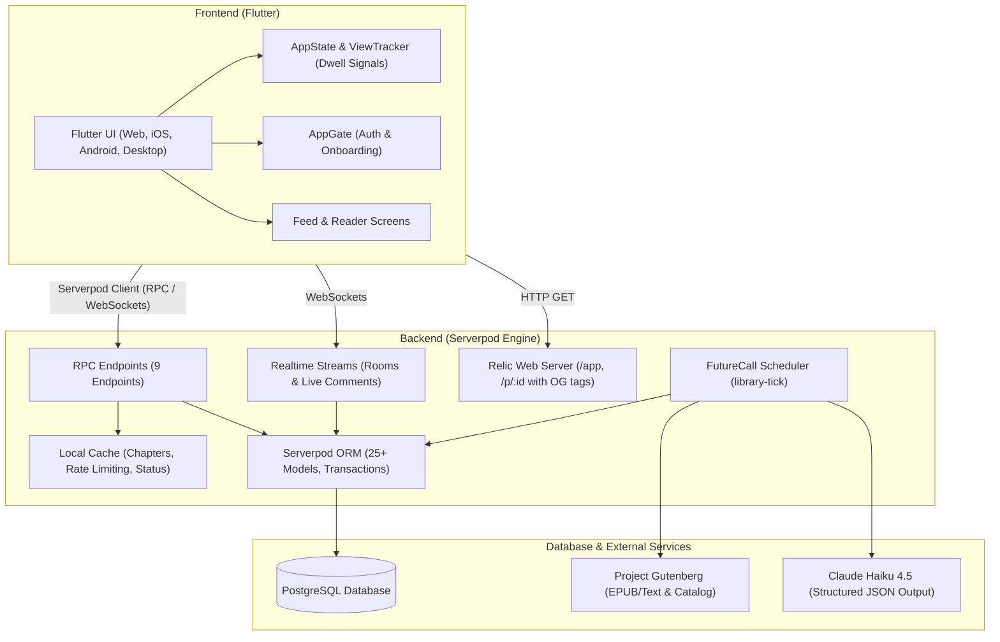

# Limick

> **Keep scrolling. Keep learning.** A social feed where every post is grounded in a real public-domain book, one tap away from the exact chapter it came from.

Built for the **Serverpod Hackathon (October 2026)**.

---

## The Pitch

Most social feeds extract attention and leave you with nothing. Reading long-form classics is rewarding, but hard to start when you have five spare minutes.

**Limick bridges the two.** It looks and scrolls like a modern social network, but every post is generated by AI from a real Project Gutenberg book passage. If an insight, verbatim quote, vocabulary word, or debate hook catches your interest, tapping it opens the exact chapter and section in a distraction-free reader.

Each book acts as its own creator account (e.g. `@OriginOfSpecies`, `@WealthOfNations`, `@Meditations`), allowing readers to follow books, participate in chapter discussions, join topic study rooms, and build a Leitner-spaced vocabulary bank.

---

## Key Features

- **Personalised "For You" Feed**: Ranks posts using multi-factor affinity scores (dwell time, likes, saves, quiz responses, comments, follows). Incorporates exploration slots (15% out-of-bubble discovery) and diversity rules (no book repeated twice within three cards; rotating post kinds).
- **Six Grounded Post Kinds**:
  - **Insight**: Punchy analysis of a core thesis from the passage.
  - **Quote**: Striking excerpt, verified character-for-character against the book text.
  - **Word**: Uncommon or archaic vocabulary with definitions and context, saveable to your personal word bank.
  - **Thread**: Multi-part breakdown of an argument or narrative arc.
  - **Quiz**: Interactive multiple-choice questions with instant reveal and explanations.
  - **Debate**: Thought-provoking claim with community agree/disagree voting.
- **In-App Reader**: Tap any card to jump directly to the chapter and highlighted passage that generated it. Tracks reading progress and resume points.
- **Real-Time Topic & Book Rooms**: Live discussion rooms for each subject (Philosophy, Science, Law, Medicine, etc.) and per-book clubs, with real-time presence indicators via Serverpod streams.
- **Live Threaded Comments**: One-level nested discussions with real-time WebSocket updates, likes, and moderation filtering.
- **Spaced-Repetition Word Bank**: Leitner 5-box review system seamlessly woven into the feed and available in a dedicated study tab.
- **Study Breaks & Streaks**: Timed reading break sessions with summary retrospectives, streak tracking across timezones, and GDPR-compliant data export/account deletion.
- **Shareable Web Previews (`/p/:id`)**: Server-rendered cards with OpenGraph metadata, allowing posts to be shared anywhere on the web.

---

## Architecture



---

## How Serverpod Is Used

Limick is built from the ground up to leverage the full Serverpod ecosystem:

| Serverpod Feature | How Limick Uses It |
|---|---|
| **Authentication & IdP** | `serverpod_auth_idp_server` with email/password authentication, JWT token management, automatic session verification, and secure password hashing. |
| **ORM & Data Models** | 25+ `.spy.yaml` data models with tables, relations, foreign keys, cascade deletes, and composite indexes (e.g., `Post`, `Book`, `Chapter`, `Reader`, `Comment`, `Room`, `SavedWord`, `TopicAffinity`). |
| **RPC Endpoints** | 9 structured endpoints (`profile`, `feed`, `book`, `comment`, `room`, `word`, `studyBreak`, `moderation`, `library`) with session validation, custom `AppException` error hierarchy, and rate limiting. |
| **Realtime Streams** | WebSocket streaming in `CommentEndpoint.watch` and `RoomEndpoint.live` for instant message delivery and dynamic presence counters. |
| **FutureCall Scheduling** | Recurring background worker (`library-tick`, every 20s) managing book ingestion, chapter parsing, catalog imports, and LLM post generation. |
| **Local Caching** | `session.caches.local` for chapter text caching, rate limit enforcement markers, and public library status metrics. |
| **Relic Web Server** | Embedded web server serving the Flutter Web single-page application at `/app` and dynamic SSR share cards at `/p/:id` with OpenGraph meta tags. |
| **Database Transactions & Raw SQL** | Atomic multi-table updates for generation and account deletion, plus raw SQL upserts for high-frequency reader affinity scoring. |
| **Integration Testing** | Robust end-to-end test suite built with `withServerpod` and `serverpod_test`, utilizing embedded test PostgreSQL without Docker dependencies. |

---

## Screenshots

> _Placeholder: App screenshots showing Feed, Reader, Live Rooms, and Word Bank._
>
> | Feed (Dark Mode) | Book Reader | Live Discussion Room | Word Bank |
> |:---:|:---:|:---:|:---:|
> | *(Feed with Insight & Quiz)* | *(Chapter with Highlight)* | *(Realtime presence)* | *(Leitner flashcard)* |

---

## Build & Run Instructions

### Prerequisites
- Dart SDK `^3.10.0` or Flutter SDK `^3.35.0`
- PostgreSQL (or rely on Serverpod's embedded database)
- Anthropic API Key (for automated post generation)

### 1. Configure Secrets
Create or edit `limick_server/config/passwords.yaml`:
```yaml
shared:
  anthropicApiKey: 'your-anthropic-api-key-here'
```
*(Alternatively, set the environment variable `SERVERPOD_PASSWORD_anthropicApiKey`.)*

### 2. Start the Server & App
In the server directory:
```bash
cd limick_server
serverpod start
```
`serverpod start` will:
1. Boot the embedded PostgreSQL database.
2. Apply pending database migrations.
3. Start the Serverpod API server (port 8080) and Web server (port 8082).
4. Launch the background library ingestion and post-generation pipeline.
5. Automatically serve the Flutter application.

### 3. Testing Credentials / Demo Access
- Sign up with any valid email format (e.g. `judge@limick.app`).
- In development mode, the email verification code is printed directly to the server console log.
- Follow the 5-step onboarding flow to pick your field of study, favorite topics, and initial followed books.

---

## Running Tests

All server unit and integration tests run self-contained against Serverpod's managed test database:

```bash
cd limick_server
dart test
```

To run Flutter widget tests:
```bash
cd limick_flutter
flutter test
```

---

## AI Disclosure & Models Used

- **Development & Architecture**: System architecture design, full-stack scaffolding, complex refactoring, and integration testing built with **Claude Opus 5.5** and Claude Code.
- **Context Synthesis & Analysis**: Rapid contextual analysis, passage synthesis, and prompt tuning supported by **Gemini 3.8 Flash**.
- **Runtime Generation**: Posts are generated at runtime by **Claude Haiku 4.5** (`claude-haiku-4-5`) via the Messages API using strict JSON-schema structured outputs.
- **Strict Grounding & Verification**: Every generated quote and vocabulary word is validated character-for-character against the original Gutenberg text before database insertion. Posts with hallucinations or unverified quotes are automatically discarded by the validation engine.

---

## Data Licensing & Attribution

- All books ingested by Limick are in the **public domain** within the United States and sourced from [Project Gutenberg](https://www.gutenberg.org).
- In compliance with Project Gutenberg trademark guidelines, all PG header/footer license blocks are stripped from stored chapter texts, and clear attribution is displayed in the reader and book profile views.
